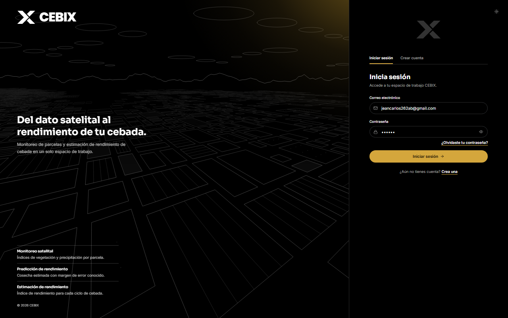
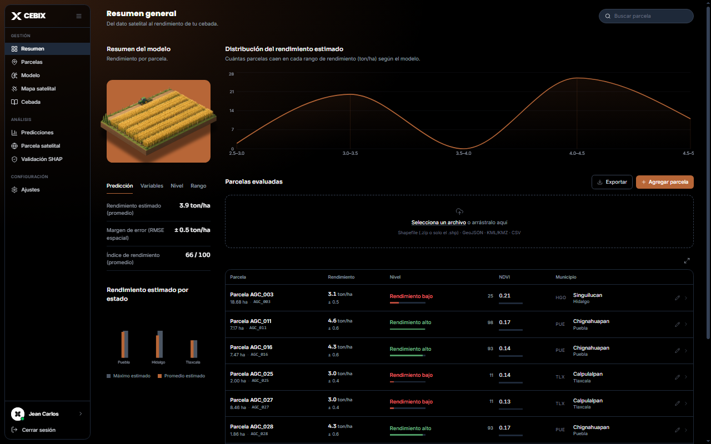
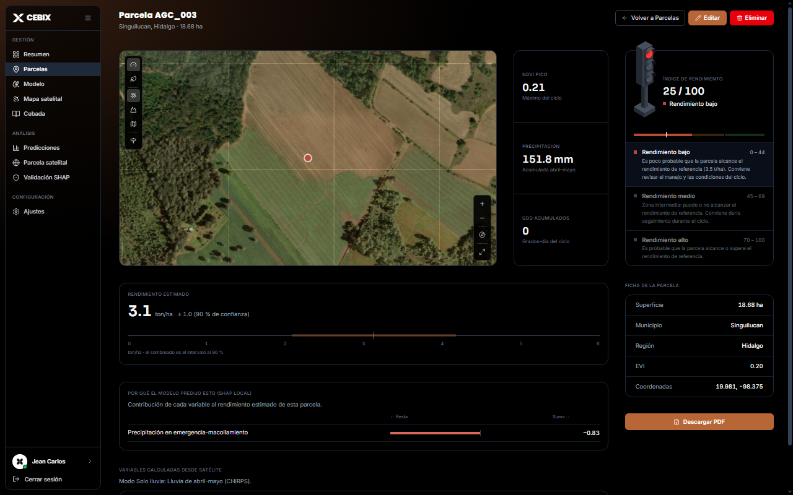
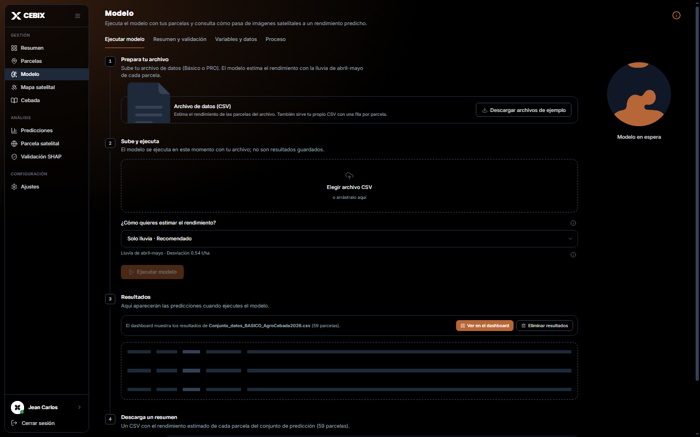
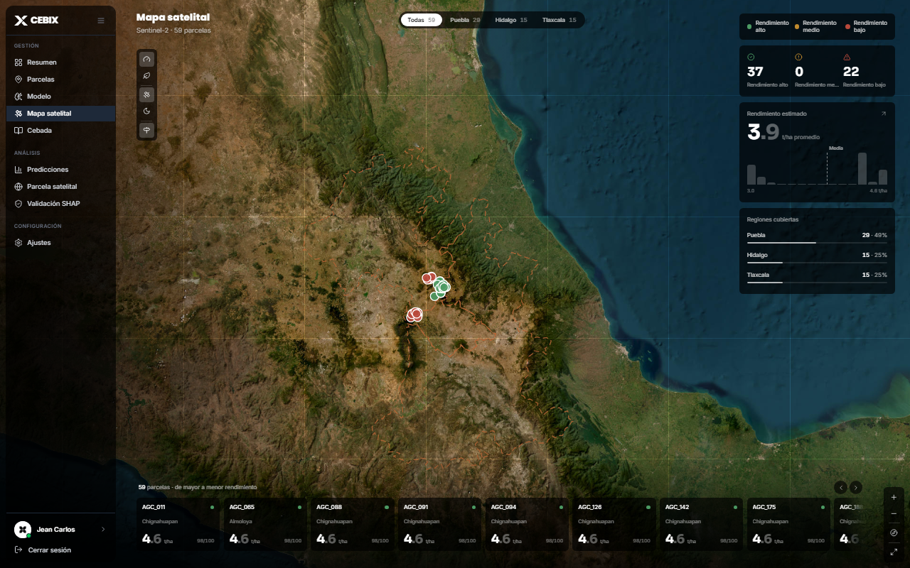
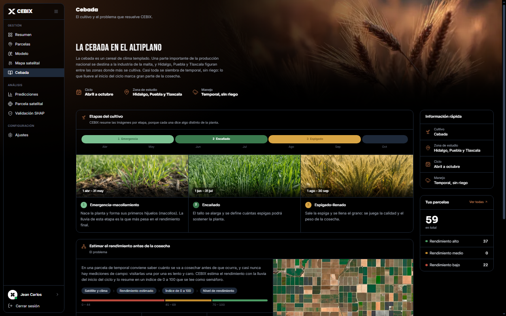
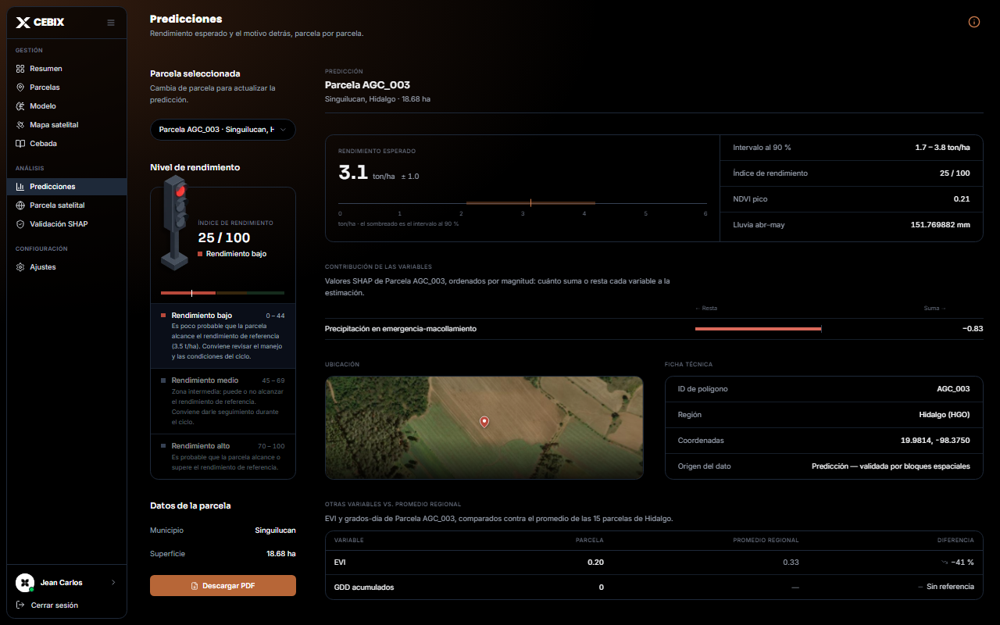
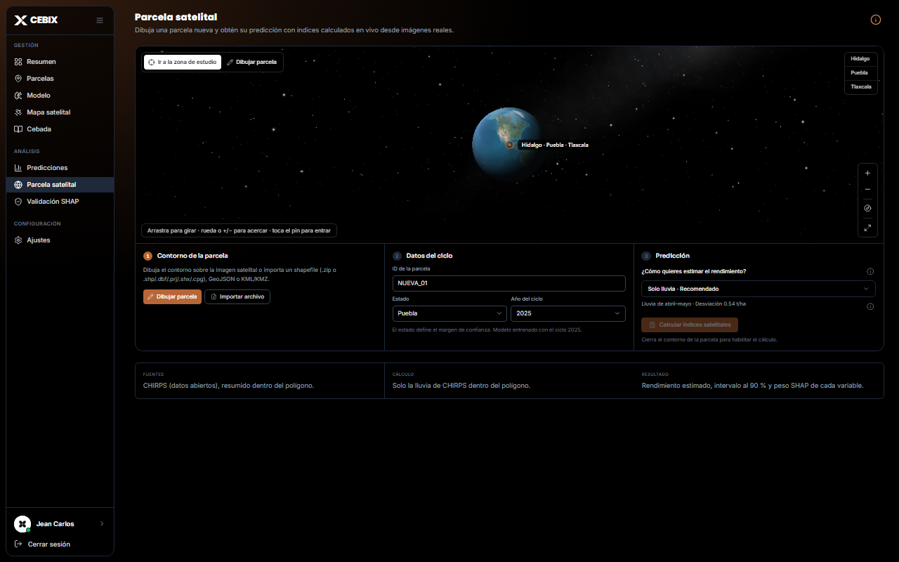
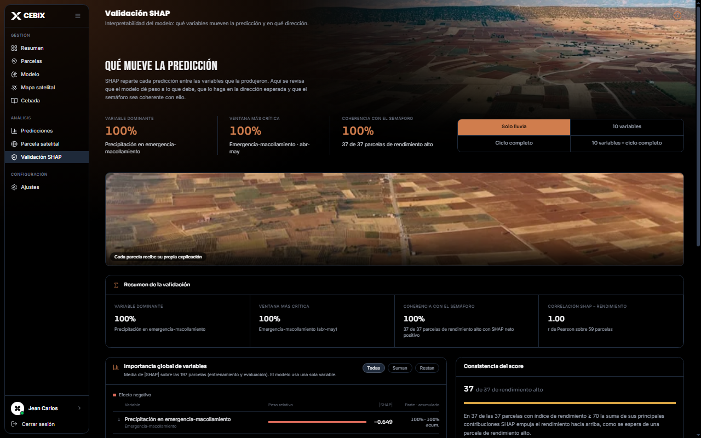
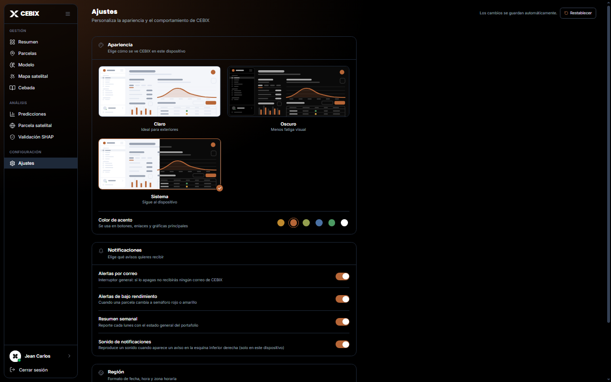

 

<h3>Ce<strong>bix</strong></h3>

<b>Predice el rendimiento de tu cebada antes de la cosecha</b>

 

 

**Cebix** es un dashboard con inferencia real para estimar el rendimiento (t/ha) de parcelas de cebada de temporal
en **Hidalgo, Puebla y Tlaxcala**. Combina lluvia satelital (CHIRPS), un modelo de Machine Learning validado
con bloques espaciales, intervalos de confianza calibrados por estado y explicabilidad con SHAP.
 
Proyecto para el Reto AgroCebada FIRA 2026

   

  

  

  

  

  

  

  

  

  

  

| Resumen | Parcelas | Modelo | Mapa satelital |
|:---:|:---:|:---:|:---:|
| Indicadores y distribución del rendimiento | Historial y detalle por parcela | Métricas, validación y modos de predicción | Globo y mapa interactivo por estado |

| Predicciones | Parcela satelital | Validación SHAP | Cebada |
|:---:|:---:|:---:|:---:|
| Rendimiento estimado, IC 90 % y semáforo | Dibuja o sube un polígono (SHP, GeoJSON, KML, KMZ) | Importancia global y local de variables | Guía del cultivo |

 

| Medida (bloques espaciales) | RMSE t/ha | R² |
|:---|:---:|:---:|
| **Modelo en producción** (Random Forest, lluvia abr–may) | **0.54** | **0.60** |
| Referencia: promedio del estado | 0.73 | 0.26 |

 

© 2026 Cebix · Todos los derechos reservados

